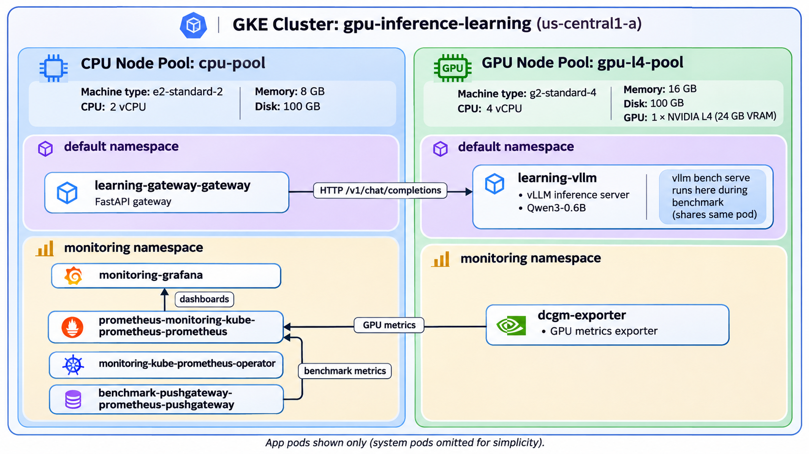

# GPU Inference Platform

A hands-on learning project for deploying an **OpenAI-compatible LLM inference service** on **Google Kubernetes Engine (GKE)**, with infrastructure managed by **Terraform**, applications deployed using **Helm**, and CI/CD orchestrated through **GitHub Actions**.

The platform serves **`Qwen/Qwen3-0.6B`** using **vLLM** on one **NVIDIA L4 GPU**. A **FastAPI gateway** runs separately on a CPU node and forwards inference requests to vLLM over the cluster network. An optional monitoring stack uses **Prometheus**, **Grafana**, and **NVIDIA DCGM Exporter** to observe the GPU and vLLM scheduler.

> **Infrastructure status:** A Terraform Destroy workflow and subsequent absence of GKE clusters/VMs were verified on **November 4, 2026**, but the platform was running again for **November 5 benchmarking**. Its current live/deleted status has **not been reverified** as part of this documentation update. Provisioning or keeping the platform running creates **billable cloud resources**.

## Architecture



The diagram shows the current **single-GPU benchmark layout**: the FastAPI gateway and monitoring stack run in the CPU node pool, while vLLM and the temporary `vllm bench serve` client run inside the **same `learning-vllm` pod** on the L4 GPU node. The client primarily generates HTTP traffic using CPU, while the model server uses the NVIDIA L4 for inference. The cluster namespaces (`default` and `monitoring`) are logical groupings; node-pool selection and scheduling determine where workloads execute.

### Why does most monitoring run on the CPU node pool?

Prometheus scrapes, stores, and queries metrics; Grafana displays dashboards; Pushgateway receives benchmark results; and Prometheus Operator manages monitoring resources. **None needs GPU compute.** Scheduling these components on `cpu-pool` saves the GPU node's CPU and RAM capacity for vLLM scheduling, tokenization, request handling, and inference. It also reduces monitoring-induced interference in performance measurements. The CPU node also hosts the FastAPI gateway, so it isn't dedicated to monitoring alone. Monitoring could technically be scheduled on the GPU node if scheduling constraints and capacity allowed, but it would compete for the same host resources.

### Why does NVIDIA DCGM Exporter run on the GPU node?

**DCGM Exporter needs local access to NVIDIA GPU/driver telemetry** to expose hardware metrics such as GPU utilization, VRAM usage, power consumption, and temperature. It therefore runs in the `monitoring` namespace **on the L4 GPU node**. Prometheus on the CPU node can scrape its HTTP metrics endpoint over the Kubernetes network; Grafana queries Prometheus. DCGM Exporter does not need to run on the CPU node alongside Prometheus, and Prometheus does not need direct physical GPU access.

```text
Client (Cloud Shell / local laptop)
               |
               | HTTP /v1/chat/completions
               v
     [kubectl port-forward: 8080]
               |
               v
     GKE cluster: gpu-inference-learning
     |
     +-- CPU pool: cpu-pool (1 x e2-standard-2)
     |     |
     |     +-- FastAPI gateway Pod
     |           Service: learning-gateway-gateway:8080
     |                  |
     |                  | Internal Kubernetes HTTP
     |                  v
     +-- GPU pool: gpu-l4-pool (0 or 1 x g2-standard-4)
           |
           +-- vLLM Pod: Qwen/Qwen3-0.6B
                 NVIDIA L4: 24 GB VRAM
                 Service: learning-vllm:8000
                 Routes: /v1/models, /v1/chat/completions, /metrics
```

**Division of responsibilities:** FastAPI receives and forwards API requests; vLLM handles tokenization, inference scheduling, continuous batching, KV-cache management, and response generation; the L4 runs the underlying transformer computations. Services are **ClusterIP/internal**, not publicly exposed.

## Infrastructure

| Component | Configuration |
| --- | --- |
| Cloud | Google Cloud / GKE Standard, `us-central1-a` |
| Cluster | `gpu-inference-learning` |
| CPU node pool | `cpu-pool`: 1 × `e2-standard-2` (2 vCPUs, 8 GB RAM, 100 GB boot disk) |
| GPU node pool | `gpu-l4-pool`: 0 or 1 × `g2-standard-4` (4 vCPUs, 16 GB RAM, 100 GB boot disk) |
| GPU | 1 × NVIDIA L4, 24 GB VRAM when GPU pool is scaled to 1 |
| Model/server | `Qwen/Qwen3-0.6B` via vLLM |
| Applications | FastAPI gateway on CPU pool, vLLM on GPU pool |
| IaC / delivery | Terraform + GCS remote state, GitHub Actions OIDC/WIF, Helm |

The GPU pool can exist with **zero worker nodes**. CPU-only infrastructure still incurs cloud charges; an active L4 node adds GPU/VM charges. GPU quota approval does not guarantee zonal capacity.

## Repository layout

| Path | Purpose |
| --- | --- |
| [`terraform/`](terraform/) | GKE cluster, CPU pool, optional NVIDIA L4 GPU pool, remote-state backend |
| [`helm/vllm/`](helm/vllm/) | vLLM Deployment and internal Service, GPU resource request and scheduling |
| [`helm/gateway/`](helm/gateway/) | FastAPI gateway, ConfigMap-backed application code and internal Service |
| [`benchmarks/`](benchmarks/) | Concurrency, varied-prompt and staggered-arrival load tests, final results JSON and reproducible script |
| [`benchmarks/README.md`](benchmarks/README.md) | Measurements, interpretation, graphs, and reproduction commands |
| [`monitoring/`](monitoring/) | Prometheus/Grafana Helm values, DCGM Exporter, vLLM ServiceMonitor and original Grafana dashboard |
| [`tests/`](tests/) | Inference smoke-test script |
| [`.github/workflows/`](.github/workflows/) | Validation, provision, scale, deploy, destroy, and combined startup workflows |

## Start the platform

### One workflow (recommended)

Use **[Start GPU Inference Platform](.github/workflows/start-platform.yml)** from **Actions → Run workflow**, on branch `main`. Enter the confirmation text:

```text
START_GPU_PLATFORM
```

The workflow runs these operations in order:

1. Authenticate GitHub Actions to Google Cloud using OIDC and Workload Identity Federation.
2. Initialize Terraform from the GCS remote state and create the GKE cluster, CPU pool (1 node), and GPU pool (**0 nodes**).
3. Apply Terraform again with `gpu_node_count=1` to provision the NVIDIA L4 worker.
4. Configure `kubectl` and wait for both node pools to become Ready.
5. Install the vLLM Helm chart and wait for readiness.
6. Install the FastAPI gateway Helm chart and verify deployments/Services.

**Note:** The combined startup workflow has been committed but had **not been tested end-to-end** as of this README update. It creates billable resources. A failed workflow **does not automatically roll back** infrastructure already created: inspect the run and run the destroy workflow if you are stopping.

### Individual workflows (alternative)

These remain useful for learning and troubleshooting:

| Order | Workflow | Input |
| --- | --- | --- |
| 1 | [Terraform Apply (CPU-only GKE)](.github/workflows/terraform-apply.yml) | `DEPLOY_CPU_ONLY` |
| 2 | [Scale NVIDIA L4 GPU Node Pool](.github/workflows/terraform-scale-gpu.yml) | GPU count `1`; confirmation `SCALE_GPU` |
| 3 | [Deploy vLLM](.github/workflows/deploy-vllm.yml) | `DEPLOY_VLLM` |
| 4 | [Deploy FastAPI Gateway](.github/workflows/deploy-gateway.yml) | Manually dispatch |

**Prerequisites:** A GCP project with billing enabled, the needed GKE/Compute APIs and GPU quotas, the preconfigured GitHub repository variables (`GCP_PROJECT_ID`, `GCP_WIF_PROVIDER`, `GCP_SERVICE_ACCOUNT`), authorized Workload Identity Federation, and access to the existing GCS backend bucket `gpu-inference-tfstate-4643030840`.

### Verify after startup

In Cloud Shell or another environment authenticated to the project:

```bash
gcloud container clusters get-credentials gpu-inference-learning \
  --zone us-central1-a --project project-36527308-968f-4297-96e

kubectl get nodes -o wide
kubectl get pods -o wide
kubectl get svc learning-vllm learning-gateway-gateway
```

For direct inference through the gateway, start a port-forward in one terminal:

```bash
kubectl port-forward svc/learning-gateway-gateway 8080:8080
```

From another terminal, check the forwarded API:

```bash
curl -sS http://localhost:8080/v1/models
```

To verify response generation, run the smoke test or load tests below. Local port-forwarding is a temporary development access method, not a public endpoint.

## Benchmarks and findings

Initial benchmarks from **November 4, 2026** measured client-observed latency and aggregate **output-token** throughput on the L4. Results are individual trials, not statistically robust production benchmarks.

| Concurrency | Identical-prompt aggregate throughput |
| ---: | ---: |
| 1 | 52.31 output tokens/s |
| 5 | 135.73 output tokens/s |
| 10 | 279.30 output tokens/s |
| 20 | **318.95 output tokens/s** |

At concurrency 20 with varied prompts: **20/20 succeeded**, **1.987 s** wall-clock, and **273.76 output tokens/s**. Different prompt/output lengths limit direct comparison with the identical-prompt test.

The **staggered-arrival** experiment sent three longer requests at approximately t=0 and two short requests at t=1 second. The later requests completed while the original three were still active. Samples from vLLM's `/metrics` endpoint showed:

```text
running requests: 0 -> 3 -> 4 -> 3 -> 0
waiting requests: 0 in observed samples
```

This is evidence of **dynamic request admission consistent with continuous batching**; it does not directly measure GPU batch membership at each token step or quantify speedup against static batching.

See the [full benchmark results, caveats, and charts](benchmarks/README.md), including:

- [Throughput vs. concurrency](benchmarks/charts/throughput-vs-concurrency.svg)
- [Average latency vs. concurrency](benchmarks/charts/latency-vs-concurrency.svg)
- [Client-observed staggered request lifetime](benchmarks/charts/continuous-batching-request-lifetime.svg)
- [Sampled vLLM running/waiting requests](benchmarks/charts/continuous-batching-scheduler-metrics.svg)

### Reproduce load tests

With the gateway port-forward running, from the repository root:

```bash
python3 -m pip install --user httpx
python3 benchmarks/load_test.py 5 --mode identical
python3 benchmarks/load_test.py 20 --mode varied
python3 benchmarks/load_test_continuous_batching.py --delay 1
```

To inspect vLLM metrics, use a **separate** port-forward:

```bash
kubectl port-forward svc/learning-vllm 8000:8000
```

Then in another terminal:

```bash
curl -sS http://localhost:8000/metrics | grep -i 'num_requests'
```

### Final incident-analysis concurrency benchmark — November 5, 2026

The final experiment used **16 rotating incident-analysis prompts** with an average input size of **387.7 tokens**, `max_tokens=256`, and no worker think time. Each worker sent one request at a time and immediately submitted another after the complete response. Tests ran for 60-second admission windows with 300-second cooldowns, **directly through a port-forward to vLLM** (bypassing the FastAPI gateway).

| Workers | Completed requests | Requests/sec | Aggregate output tokens/sec | p95 end-to-end latency | Errors |
| ---: | ---: | ---: | ---: | ---: | ---: |
| 4 | 108 | 1.78 | 455.35 | 2.359 s | 0 |
| 8 | 193 | 3.12 | 798.50 | 2.671 s | 0 |
| 16 | 313 | 5.01 | 1,281.51 | 3.400 s | 0 |

Aggregate output throughput grew **2.81×** from 4 to 16 workers, while p95 completion latency increased about **44%**. This is consistent with a throughput–latency tradeoff from increased concurrent inference. Sampled vLLM waiting requests remained at zero, and KV-cache occupancy was visually around 5% at 16 workers; 30-second Prometheus scrapes may miss transient waiting. **No throughput plateau or maximum-user capacity was established.**

All three runs were single trials. Shared prompt prefixes and repeated scenarios may benefit from prefix caching; nearly every response reached the 256-token cap. These are bounded-output serving measurements, **not proof of incident-response quality or production capacity**.

- [Detailed experimental findings and Grafana screenshots](benchmarks/exploratory-results.md)
- [Recorded results JSON](benchmarks/final-results.json)
- [Benchmark Python script](benchmarks/final-benchmark.py)

## Interactive Grafana benchmark dashboard

**[View the public Grafana snapshot — GPU Inference (November 5, 2026)](https://snapshots.raintank.io/dashboard/snapshot/9WBYMrSxAy3BhRiCADuB8eZkMJL1tYhx)**

This is a **public, read-only snapshot** of the seven-panel GPU and vLLM monitoring dashboard, captured for the November 5, 2026 concurrency benchmark. It includes GPU utilization, VRAM allocation, temperature, power, KV-cache occupancy, running requests, and waiting requests. The snapshot is **historical and does not update live** or require the GKE cluster to stay running.

The [original Grafana dashboard JSON](monitoring/gpu-inference-dashboard.original.json) is archived separately for restoring panel configurations. Recorded throughput and latency are in the [benchmark report](benchmarks/exploratory-results.md).

## GPU and vLLM monitoring

The benchmark environment included **Prometheus, Grafana and NVIDIA DCGM Exporter**. DCGM exposed GPU utilization, framebuffer VRAM usage, temperature and power, while vLLM exposed running requests, waiting requests and KV-cache occupancy. The original seven-panel **GPU Inference** dashboard has been preserved as Grafana's `dashboard.grafana.app/v2` JSON resource.

The repository includes:

- [Prometheus/Grafana stack values](monitoring/stack-values.yaml)
- [DCGM Exporter values](monitoring/dcgm-values.yaml)
- [vLLM ServiceMonitor](monitoring/vllm-servicemonitor.yaml)
- [Original Grafana dashboard configuration](monitoring/gpu-inference-dashboard.original.json)
- [Monitoring deployment and metric verification instructions](monitoring/README.md)

**Reproducibility status:** The monitoring configuration reflects the setup used during the benchmark, but a **clean end-to-end rebuild from the committed files has not been verified**. The normal Start Platform workflow deploys the cluster, vLLM and gateway; it does **not currently install the monitoring stack automatically**. The original dashboard JSON preserves panel definitions and queries, not historical Prometheus samples.

## Further work

- Verify the committed monitoring manifests against a fresh deployment, including Prometheus scrape targets and Grafana dashboard restoration.
- Add streaming measurements (TTFT, time per output token, p50/p95) and controlled saturation tests with varied prompts and repeated trials.
- Consider monitoring deployment automation, reliability tests and request authentication before any broader use.

The first-pass monitoring and KV-cache observation work is **complete**, with supporting measurements in [the final benchmark report](benchmarks/exploratory-results.md). Capacity limits have not yet been established.

## Shut down to control costs

Run **[Terraform Destroy (GKE)](.github/workflows/terraform-destroy.yml)** from GitHub Actions and enter:

```text
DESTROY_GKE
```

It removes the **Terraform-managed** GKE cluster and node pools. When the cluster is deleted, its Pods, Deployments and internal Services disappear as well. It intentionally **does not delete** the externally managed Terraform state bucket, GitHub repository, Workload Identity Federation setup, or standalone resources not in Terraform state.

Verify:

```bash
gcloud container clusters list --project=project-36527308-968f-4297-96e
gcloud compute instances list --project=project-36527308-968f-4297-96e
gcloud compute disks list --project=project-36527308-968f-4297-96e
```

Also inspect any independently created disks, load balancers, reserved IPs, NAT resources or storage, and review Google Cloud Billing (which can report costs with a delay). **Do not manually delete the GCS state bucket** if you intend to resume using the existing Terraform workflows.

## Security notes

This is a learning environment, not a production-hardened deployment. The services are internal, and the FastAPI gateway currently does not implement application-level authentication. Avoid publicly exposing inference endpoints without authentication, use least-privilege IAM, and keep credentials/TF state out of source control. Always shut down unused billable resources.
