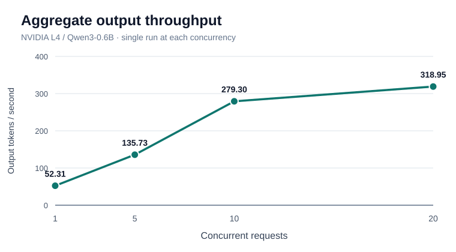
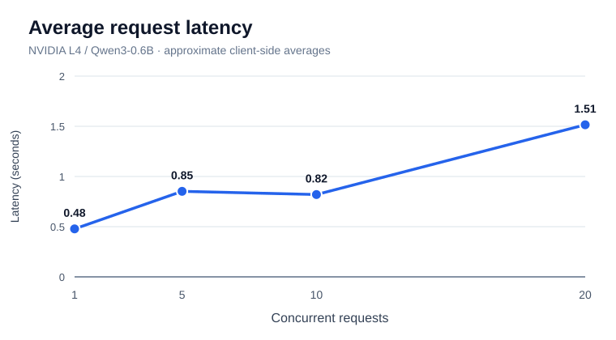

# Inference load-testing experiments

This document records initial experiments on the learning-only GKE GPU inference platform. Requests followed:

`Cloud Shell -> kubectl port-forward -> FastAPI gateway (CPU node, :8080) -> learning-vllm Service (:8000) -> vLLM (NVIDIA L4 GPU)`

## Environment

- GPU: 1 x NVIDIA L4 on a GKE `g2-standard-4` node
- CPU: GKE `e2-standard-2` node running the FastAPI gateway
- Model: `Qwen/Qwen3-0.6B`; vLLM serving the OpenAI-compatible chat completions API
- Client: Python `asyncio` + HTTPX, running in Google Cloud Shell through a local port-forward
- Requests sent concurrently with `asyncio.gather()`
- Original identical-prompt script used the message `Explain Kubernetes in one sentence. /no_think`, `temperature=0`, `max_tokens=100`
- Measurements captured on 2026-11-04 and manually transcribed from Cloud Shell results shared during the project

## Completed measurements: identical prompts

The following are *single-run observations*, not statistical averages or a production benchmark.

| Concurrent requests | Wall-clock time (s) | Total output tokens | Aggregate output throughput (tokens/s) |
| ---: | ---: | ---: | ---: |
| 1 | 0.478 | 25 | 52.31 |
| 5 | 0.921 | 125 | 135.73 |
| 10 | 0.895 | 250 | 279.30 |
| 20 | 1.568 | 500 | 318.95 |

## Visualizations

The following charts show the single-run identical-prompt experiment results.

### Aggregate throughput vs concurrency



The sum of output tokens from all requests divided by the wall-clock time increased as concurrency increased.

### Average request latency vs concurrency



Approximate client-side average latencies (seconds) transcribed from the original on-screen results:

| Concurrent requests | Approximate average request latency (s) |
| ---: | ---: |
| 1 | 0.478 |
| 5 | 0.852 |
| 10 | 0.820 |
| 20 | 1.515 |

**Caution:** Average latency values are approximate; the original per-request raw timing data for all runs is not stored. The single-request value includes a small amount of client-side overhead. The charts reflect single-run measurements, not repeat-trial averages.

An earlier separate five-request run recorded 0.803 s wall-clock, 125 output tokens, and 155.60 output tokens/s. This shows run-to-run variation.

A separate single-request upstream timing measurement printed by FastAPI was **246.10 ms**. This is the time spent awaiting the HTTPX upstream call to vLLM, and should **not** be directly equated with client-side latency or GPU compute-only time.

### Metric definitions

- **Request latency:** elapsed client-side time for one POST and its full response
- **Average latency:** arithmetic mean of successful request latencies
- **Wall-clock time:** elapsed time from starting the batch until all requests finish (including client-side overhead)
- **Aggregate output throughput:** sum of output tokens in successful responses divided by batch wall-clock time; not throughput for any one request
- A single-request result is not a steady-state throughput measurement. Client/network overhead and short outputs materially affect these values.

## Completed measurement: varied prompts

A subsequent single run used **20 concurrent different prompts**, each requesting a one-sentence answer with `/no_think`, `temperature=0`, and `max_tokens=100`. The questions covered Kubernetes, Docker, Terraform, Python, GPU infrastructure, and related concepts.

| Metric | Identical prompts | Different prompts |
| --- | ---: | ---: |
| Concurrent requests | 20 | 20 |
| Successful requests | 20 | 20 |
| Wall-clock time | 1.568 s | 1.987 s |
| Average request latency | ~1.515 s | 1.815 s |
| Total output tokens | 500 | 544 |
| Aggregate throughput | 318.95 tok/s | 273.76 tok/s |

For the varied-prompt run, all 20 responses had `finish_reason=stop`. These observations represent **one trial of each workload**; differences are not attributable solely to prompt variation because prompt lengths, output lengths, scheduling, caching and other factors vary. The throughput was about 14% lower and average latency about 20% higher in this single comparison.

## Reproducing the benchmarks

From the repository root, with `kubectl` connected to the GKE cluster:

Terminal 1:

```bash
kubectl port-forward svc/learning-gateway-gateway 8080:8080
```

Terminal 2:

```bash
python3 -m pip install --user httpx
python3 benchmarks/load_test.py 1 --mode identical
python3 benchmarks/load_test.py 5 --mode identical
python3 benchmarks/load_test.py 10 --mode identical
python3 benchmarks/load_test.py 20 --mode identical
```

Try different prompts with:

```bash
python3 benchmarks/load_test.py 20 --mode varied
```

The completed 20-request varied-prompt run is recorded above. Prompt lengths and response lengths differ from the identical-prompt workload.

To inspect FastAPI's upstream HTTP timings:

```bash
kubectl logs deployment/learning-gateway-gateway --tail=100 | grep "vLLM request latency"
```

## Staggered-arrival continuous batching experiment

A separate [Python experiment](load_test_continuous_batching.py) starts three long-generation requests and introduces two shorter requests after a configurable delay. It prints when each request begins and finishes relative to a shared clock.

```bash
# With the FastAPI gateway port-forward still running
python3 benchmarks/load_test_continuous_batching.py

# Optional: send late requests after 0.5 seconds instead of 1 second
python3 benchmarks/load_test_continuous_batching.py --delay 0.5
```

Initial requests allow up to 512 output tokens and late requests up to 80 (both configurable). Requests are non-streaming because the current FastAPI gateway buffers vLLM responses. **Timing overlap is not enough to prove that the vLLM scheduler performed continuous batching.** That requires inspecting vLLM metrics or traces showing active/waiting requests and new admissions during ongoing decode. No results from this experiment have been recorded yet.

## Interpretation and limitations

Throughput increased with concurrency in these initial runs, consistent with overlapping work and possible continuous batching. The exact internal batching behavior was **not measured**. Since all original prompts were identical, cache reuse may influence results if prefix caching was enabled. No repeated trials, warm-up standardization, token-length matching, GPU utilization measurements, streaming TTFT, p95 latency, or GPU-only timings were collected. The script currently uses non-streaming responses.

For better comparisons: repeat every concurrency setting several times, collect average/p95 latency, use mixed prompt and output lengths, check prefix-caching configuration, and inspect GPU utilization and vLLM metrics.

## Costs and safety

The GKE GPU VM incurs charges while it is running. Scale the GPU node pool back to zero or run the Terraform destroy workflow when experiments finish. The API is intentionally internal to the cluster and exposed to Cloud Shell only through temporary port-forwarding.
