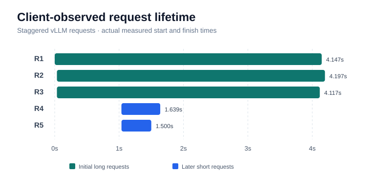
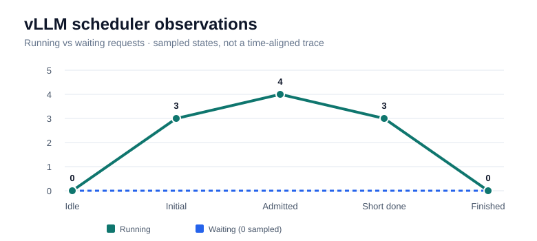

# Inference load-testing experiments

This document records initial experiments on the learning-only GKE GPU inference platform. Requests followed:

`Cloud Shell -> kubectl port-forward -> FastAPI gateway (CPU node, :8080) -> learning-vllm Service (:8000) -> vLLM (NVIDIA L4 GPU)`

## Environment

- GPU: 1 x NVIDIA L4 on a GKE `g2-standard-4` node
- CPU: GKE `e2-standard-2` node running the FastAPI gateway
- Model: `Qwen/Qwen3-0.6B`; vLLM serving the OpenAI-compatible chat completions API
- Client: Python `asyncio` + HTTPX, running in Google Cloud Shell through a local port-forward
- Requests sent concurrently with `asyncio.gather()`
- Original identical-prompt script used the message `Explain Kubernetes in one sentence. /no_think`, `temperature=0`, `max_tokens=100`
- Measurements captured on 2026-11-04 and manually transcribed from Cloud Shell results shared during the project

## Completed measurements: identical prompts

The following are *single-run observations*, not statistical averages or a production benchmark.

| Concurrent requests | Wall-clock time (s) | Total output tokens | Aggregate output throughput (tokens/s) |
| ---: | ---: | ---: | ---: |
| 1 | 0.478 | 25 | 52.31 |
| 5 | 0.921 | 125 | 135.73 |
| 10 | 0.895 | 250 | 279.30 |
| 20 | 1.568 | 500 | 318.95 |

## Visualizations

The following charts show the single-run identical-prompt experiment results.

### Aggregate throughput vs concurrency


The sum of output tokens from all requests divided by the wall-clock time increased as concurrency increased.

### Average request latency vs concurrency


Approximate client-side average latencies (seconds) transcribed from the original on-screen results:

| Concurrent requests | Approximate average request latency (s) |
| ---: | ---: |
| 1 | 0.478 |
| 5 | 0.852 |
| 10 | 0.820 |
| 20 | 1.515 |

**Caution:** Average latency values are approximate; the original per-request raw timing data for all runs is not stored. The single-request value includes a small amount of client-side overhead. The charts reflect single-run measurements, not repeat-trial averages.

An earlier separate five-request run recorded 0.803 s wall-clock, 125 output tokens, and 155.60 output tokens/s. This shows run-to-run variation.

A separate single-request upstream timing measurement printed by FastAPI was **246.10 ms**. This is the time spent awaiting the HTTPX upstream call to vLLM, and should **not** be directly equated with client-side latency or GPU compute-only time.

### Metric definitions

- **Request latency:** elapsed client-side time for one POST and its full response
- **Average latency:** arithmetic mean of successful request latencies
- **Wall-clock time:** elapsed time from starting the batch until all requests finish (including client-side overhead)
- **Aggregate output throughput:** sum of output tokens in successful responses divided by batch wall-clock time; not throughput for any one request
- A single-request result is not a steady-state throughput measurement. Client/network overhead and short outputs materially affect these values.

## Completed measurement: varied prompts

A subsequent single run used **20 concurrent different prompts**, each requesting a one-sentence answer with `/no_think`, `temperature=0`, and `max_tokens=100`. The questions covered Kubernetes, Docker, Terraform, Python, GPU infrastructure, and related concepts.

| Metric | Identical prompts | Different prompts |
| --- | ---: | ---: |
| Concurrent requests | 20 | 20 |
| Successful requests | 20 | 20 |
| Wall-clock time | 1.568 s | 1.987 s |
| Average request latency | ~1.515 s | 1.815 s |
| Total output tokens | 500 | 544 |
| Aggregate throughput | 318.95 tok/s | 273.76 tok/s |

For the varied-prompt run, all 20 responses had `finish_reason=stop`. These observations represent **one trial of each workload**; differences are not attributable solely to prompt variation because prompt lengths, output lengths, scheduling, caching and other factors vary. The throughput was about 14% lower and average latency about 20% higher in this single comparison.

## Reproducing the benchmarks

From the repository root, with `kubectl` connected to the GKE cluster:

Terminal 1:

```bash
kubectl port-forward svc/learning-gateway-gateway 8080:8080
```

Terminal 2:

```bash
python3 -m pip install --user httpx
python3 benchmarks/load_test.py 1 --mode identical
python3 benchmarks/load_test.py 5 --mode identical
python3 benchmarks/load_test.py 10 --mode identical
python3 benchmarks/load_test.py 20 --mode identical
```

Try different prompts with:

```bash
python3 benchmarks/load_test.py 20 --mode varied
```

The completed 20-request varied-prompt run is recorded above. Prompt lengths and response lengths differ from the identical-prompt workload.

To inspect FastAPI's upstream HTTP timings:

```bash
kubectl logs deployment/learning-gateway-gateway --tail=100 | grep "vLLM request latency"
```

## Staggered-arrival continuous batching experiment

A separate [Python experiment](load_test_continuous_batching.py) starts three long-generation requests and introduces two shorter requests after a configurable delay. It prints when each request begins and finishes relative to a shared clock.

```bash
# With the FastAPI gateway port-forward still running
python3 benchmarks/load_test_continuous_batching.py

# Optional: send late requests after 0.5 seconds instead of 1 second
python3 benchmarks/load_test_continuous_batching.py --delay 0.5
```

Initial requests allow up to 512 output tokens and late requests up to 80 (both configurable). Requests are non-streaming because the current FastAPI gateway buffers vLLM responses.

### Recorded results: staggered arrivals (November 4, 2026)

Three long requests started at t≈0; two short requests started at t≈1 second. Two runs were recorded. The second run also included direct sampling of vLLM's Prometheus metrics and is the primary scheduler observation here.

**Latest client-side run** (`--delay 1 --short-tokens 300`):

| Request | Start (s) | Finish (s) | Latency (s) | Output tokens | Finish reason |
| --- | ---: | ---: | ---: | ---: | --- |
| R1 (long) | 0.000 | 4.147 | 4.147 | 512 | length |
| R2 (long) | 0.034 | 4.197 | 4.163 | 512 | length |
| R3 (long) | 0.034 | 4.117 | 4.082 | 494 | stop |
| R4 (later) | 1.036 | 1.639 | 0.603 | 46 | stop |
| R5 (later) | 1.037 | 1.500 | 0.463 | 31 | stop |

#### Client-observed request lifetime



The horizontal bars show the measured start-to-finish lifetime of each request. R4 and R5 start later but finish before R1–R3.

**Summary:** 5/5 successful requests; 4.197 s wall-clock; 1,595 generated output tokens. The two later requests finished while the initial three continued running. Although `--short-tokens 300` allowed longer outputs, R4 and R5 stopped naturally at 46 and 31 tokens.

**Direct vLLM scheduler metrics**, polled at roughly 200 ms plus HTTP scrape time, showed this sequence:

```text
num_requests_running: 0 -> 3 -> 4 -> 3 -> 0
num_requests_waiting: 0 throughout the observed samples
```

#### Running versus waiting requests



| Observation | Running requests | Waiting requests |
| --- | ---: | ---: |
| Idle | 0 | 0 |
| Initial requests active | 3 | 0 |
| Additional work admitted | 4 | 0 |
| Later short requests completed | 3 | 0 |
| All requests completed | 0 | 0 |

The phases summarize successive observed states; they are **not equally spaced in time**, and not every intermediate scheduler state was captured.

The increase **3 → 4** while initial requests were active is evidence of **dynamic admission of additional work**, consistent with vLLM continuous batching. No sample showed five running requests; the polling interval may have missed transient states. These gauges do not reveal individual per-token GPU batch membership or quantify speedup relative to a static scheduler.

**Earlier staggered run** (`--delay 1`, default short token limit 80): 5/5 successful; 4.096 s wall-clock; 1,562 generated tokens. Initial requests finished around t=3.843–4.096 s, whereas R4 and R5 started around t=1.034 s and finished at t=1.708 s and t=1.624 s. Its sampled metrics showed 0 → 3 → 0 running, without capturing the brief later admission.

### Inspect scheduler metrics during a new test

With a separate Cloud Shell terminal port-forwarding `svc/learning-vllm` to local port 8000, monitor:

```bash
while true; do
  date +%H:%M:%S
  curl -sS http://localhost:8000/metrics \
    | grep -E '^vllm:num_requests_(running|waiting)\\{'
  sleep 0.2
done
```

Run the staggered test via the gateway port-forward (local 8080) in another terminal. This is a learning-scale observation, not a rigorous traced scheduler benchmark.

## Interpretation and limitations

Throughput increased with concurrency in these initial runs, consistent with overlapping work and possible continuous batching. A separate staggered-arrival experiment observed dynamic request admission via the vLLM running-request gauge, but exact token-level GPU batch composition and static-batching comparative speedup were **not measured**. Since all original prompts were identical, cache reuse may influence results if prefix caching was enabled. No repeated trials, warm-up standardization, token-length matching, GPU utilization measurements, streaming TTFT, p95 latency, or GPU-only timings were collected. The script currently uses non-streaming responses.

For better comparisons: repeat every concurrency setting several times, collect average/p95 latency, use mixed prompt and output lengths, check prefix-caching configuration, and inspect GPU utilization and vLLM metrics.

## Costs and safety

The GKE GPU VM incurs charges while it is running. Scale the GPU node pool back to zero or run the Terraform destroy workflow when experiments finish. The API is intentionally internal to the cluster and exposed to Cloud Shell only through temporary port-forwarding.
