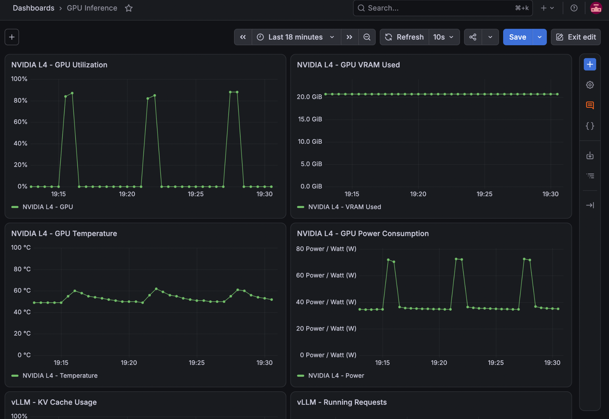
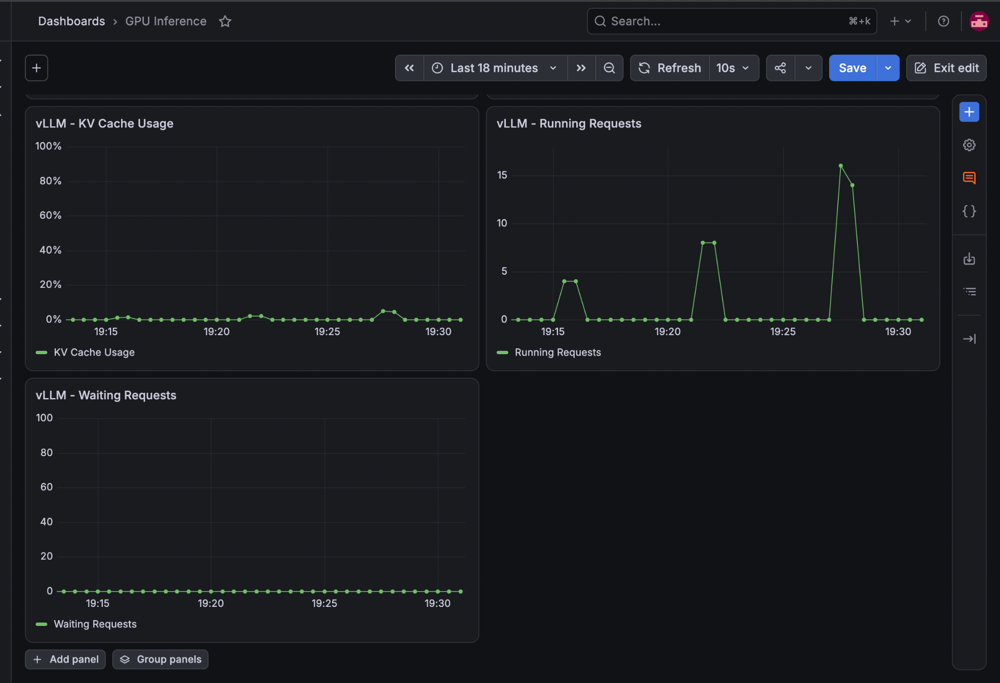

# Additional vLLM load-test history (November 5, 2026)

This page records exploratory **direct-to-vLLM** tests performed from Google Cloud Shell via `kubectl port-forward svc/learning-vllm 8000:8000`. They are distinct from the earlier gateway-based experiments in [benchmarks/README.md](README.md).

Environment: GKE, one NVIDIA L4 GPU (24 GiB VRAM), `Qwen/Qwen3-0.6B` on vLLM, OpenAI-compatible `/v1/chat/completions`, non-streaming requests, `temperature=0`, `max_tokens=256`, thinking disabled, and ~60-second closed-loop tests. One worker sends one request at a time and starts its next request only after the previous response completes. All measurements are **single-run observations** except the explicitly grouped repeated configuration.

## Experiment summary

| ID | Prompt / workload | Concurrent workers | Completed requests | Requests/sec | Output tokens/sec |
| --- | --- | ---: | ---: | ---: | ---: |
| 1 | **P1:** Short, identical Kubernetes question | 4 | 117 | 1.89 | Not recorded |
| 2 | **P1:** Short, identical Kubernetes question (**two runs grouped**) | 8 | 218–224 | 3.56–3.62 | Not recorded |
| 3 | **P2:** 40-section repetitive technical prompt; eight topics | 8 | 287 | 4.65 | Not recorded |
| 4 | **P2:** Same repetitive prompt pattern, now with token and latency measurements | 8 | 294 | 4.77 | 673.21 |
| 5a | **P3:** Sixteen incident-analysis prompts, rotated across workers | 4 | 108 | 1.78 | 455.35 |
| 5b | **P3:** Same fixed prompt pool | 8 | 193 | 3.12 | 798.50 |
| 5c | **P3:** Same fixed prompt pool | 16 | 313 | 5.01 | 1,281.51 |

**Notes:** Test 2 combines two separate runs of the same configuration; ranges are not averages. Tests 3 and 4 use the same *workload pattern* but were separate executions. The P3 tests use different prompts from P1/P2, so do not interpret cross-workload differences as pure concurrency scaling.

## Prompt definitions

### P1 — short identical prompt

Every worker sends this exact input repeatedly:

```text
Explain how Kubernetes schedules GPU workloads and manages GPU resources.
```

### P2 — long repetitive prompt

For worker ID 0–7, each worker is assigned one topic:

1. Kubernetes GPU scheduling
2. vLLM continuous batching
3. GPU memory allocation
4. Transformer attention
5. KV-cache management
6. Distributed inference
7. Model serving latency
8. GPU performance optimization

Each prompt is generated from the corresponding topic:

```python
context = " ".join(
    f"Section {i}: Explain {topic} with an example involving "
    f"GPU inference infrastructure and performance measurement."
    for i in range(40)
)
prompt = context + "\nSummarize the key ideas."
```

The same prompt is reused by each worker for multiple requests. These repetitions and potential prefix-cache reuse make P2 a synthetic input-length stress test rather than a representative user workload.

### P3 — incident-analysis prompt pool (completed final benchmark)

A pool of 16 fictional incidents: GPU saturation, KV-cache pressure, slow prefill, slow decoding, Pending GPU Pods, GPU OOM, low GPU activity, traffic bursts, uneven replicas, failed deployment, GPU temperature, missing Prometheus metrics, gateway timeouts, low prefix-cache benefits, concurrency plateau, and high inference cost.

Each prompt includes the incident's distinct symptoms, shared Kubernetes/vLLM infrastructure context, and the task of identifying root causes, proposing diagnostic checks and mitigations. A shared rotation assigns prompts across workers; no worker permanently owns a scenario. As prompts recur, prefix caching may still influence results.

Completed P3 test settings: **4, 8, 16 workers; 60-second target test duration each; 300-second cooldowns**. The actual elapsed times were 60.70, 61.87 and 62.52 seconds, respectively; requests in progress completed after the nominal deadline.

## More detailed measured results (P2, Test 4)

| Metric | Value |
| --- | ---: |
| Workers | 8 |
| Elapsed | 61.6 s |
| Completed requests | 294 |
| Errors | 0 |
| Input tokens | 237,766 |
| Output tokens | 41,461 |
| Requests/sec | 4.77 |
| Input tokens/sec | 3,860.66 |
| Output tokens/sec | 673.21 |
| Mean end-to-end latency | 1.66 s |
| Median (p50) latency | 1.59 s |
| p95 latency | 2.58 s |
| Average output tokens/request | 141.0 |

These are **aggregate** throughput measurements across concurrent requests, not the per-request decoding speed. Input tokens/sec counts submitted prompt tokens, not necessarily fresh GPU prefill computations when prefix caching is enabled.


## Final incident-analysis concurrency comparison (P3, Test 5)

All three runs completed successfully. Prompts were selected in a rotating sequence from 16 fictional incidents, each with a shared system-background section. Individual prompts averaged about 388 tokens; this is **shorter than the originally discussed ~800-token goal**. Output was capped at 256 tokens; mean generated tokens per request were 255.9, 256.0 and 256.0, so nearly all responses reached the cap.

| Metric | 4 workers | 8 workers | 16 workers |
| --- | ---: | ---: | ---: |
| Elapsed (s) | 60.70 | 61.87 | 62.52 |
| Successful requests | 108 | 193 | 313 |
| Errors | 0 | 0 | 0 |
| Requests/sec | 1.78 | 3.12 | 5.01 |
| Input tokens/sec | 689.84 | 1,209.34 | 1,941.10 |
| Output tokens/sec | 455.35 | 798.50 | 1,281.51 |
| Average input tokens/request | 387.7 | 387.7 | 387.7 |
| Average output tokens/request | 255.9 | 256.0 | 256.0 |
| Mean end-to-end latency (s) | 2.248 | 2.520 | 3.163 |
| Median/p50 latency (s) | 2.227 | 2.504 | 3.194 |
| p95 latency (s) | 2.359 | 2.671 | 3.400 |

Observed improvement from 4 to 16 workers: **2.81× higher output tokens/sec** and roughly **44% higher p95 latency**; no request errors were recorded. Highest measured aggregate throughput was at 16 workers, but no saturation point was demonstrated at or below 16 workers. One run at each concurrency level does not establish statistical significance.

The test uses a 60-second request-admission window with closed-loop workers; in-flight requests are allowed to complete. A 300-second cooldown between runs helps separate monitoring periods, but does not necessarily clear the vLLM prefix cache. Per-prompt counts were fairly balanced (4 workers: 6–7 each; 8 workers: 12–13 each; 16 workers: 19–20 each). The script runs directly against the vLLM endpoint via port-forward; the CPU FastAPI gateway is not in the measured path.

Because prompts share a substantial common background and the 16 prompts are reused, cache effects can inflate apparent prompt-processing throughput relative to entirely fresh prompts. Nearly all outputs hitting the 256-token cap means this benchmark primarily measures fixed-length generation performance, **not** the quality or completeness of the incident diagnoses. The final-run Grafana screenshot (November 5, 2026; approximately 19:13–19:31) showed three clearly separated load periods. Approximate visually sampled GPU utilization during those periods was 84–87%, 82–85%, and 88% for 4, 8, and 16 workers respectively. The GPU allocated VRAM line remained near 20.7 GiB. Temperature peaked around 60–61 °C and power around 71–73 W while loaded; idle power returned near 35 W and temperature near 49–50 °C between runs. These are visual estimates from Grafana's ~30-second scrape samples, **not** precise time-series maxima. A second screenshot of the same three test windows showed sampled running requests of **4, 8 and 16** respectively, matching configured worker counts. Visually estimated sampled KV-cache occupancy peaks were approximately **1–2%, 2–3% and 5%** respectively. Waiting requests remained **0 at all visible samples**. These are samples, not proof that queues never occurred between 30-second scrapes. Both Grafana screenshots are preserved under `benchmarks/charts/` and embedded below.

## Selected Grafana observations

During the exploratory load tests, sampled measurements included GPU utilization around 83–85%, allocated VRAM around 20.7 GiB, GPU temperature around 60–62 °C under load (49 °C idle), and power around 71–72 W under load (35 W idle). KV-cache occupancy was sampled at 2.91% in one long-prompt test and 3.72% in a later test; the later snapshot showed seven running requests and zero waiting requests.

These numbers are **individual observations**, not definitive maxima, averages or continuous measurements. Prometheus' ~30-second scrape interval can miss short spikes, and the captured screenshots/series have not all been archived here.

## Interpretation and limitations

- Different workloads have different input lengths, output lengths and caching patterns. Requests/sec across P1 and P2 should **not** be used to claim one is more efficient on a like-for-like basis.
- Two short-prompt eight-worker runs showed 3.56 and 3.62 requests/sec, modest run-to-run variation.
- P3 results are now recorded from the completed three-run benchmark on November 5, 2026. They are one run per concurrency level, not repeated trials.
- The 5-minute cooldown separates test periods in Grafana and allows return toward idle, but does not necessarily clear vLLM's prefix cache.
- The benchmark sends directly to the vLLM Service through a port-forward, **not** through the FastAPI gateway. Gateway overhead is not included.


## Interpretation: concurrency, user capacity, and serving efficiency

### What does a benchmark worker represent?

A **worker models one continuously active client**, similar to a user who immediately submits another request after receiving each completed response. It is **not** equivalent to one registered account, connected session, or a typical human user.

The Python test uses a *closed-loop* pattern:

```text
Worker: send one chat-completion request
        -> wait for full non-streaming response
        -> immediately send the next request
        -> repeat until the 60-second admission window ends
```

With 4, 8 or 16 workers, there can be **at most 4, 8 or 16 client requests in flight at a time**, respectively. Real users pause to read, type, and think; a production application may therefore support many more connected users than the number of continuously active workers. Conversely, longer prompts, longer generations, and traffic bursts can reduce the number of active requests the server can handle at a target latency.

### What the three tests demonstrate

**Aggregate throughput scaled as concurrency increased.** Moving from 4 to 16 workers raised observed completion throughput from **1.78 to 5.01 requests/sec** and aggregate output throughput from **455.35 to 1,281.51 output tokens/sec**, about **2.81×** improvement with **4×** more workers. The 8-worker midpoint delivered 3.12 requests/sec and 798.50 output tokens/sec.

vLLM's *continuous batching* provides a plausible mechanism: it can schedule and execute token-generation work for several active requests together instead of treating every request as an isolated serial GPU job. The benchmark is consistent with better aggregate GPU efficiency from increased batching opportunities; **it does not isolate batching as the only cause** of the observed gains.

**Latency rose at higher concurrency.** Median latency went from **2.227 s → 2.504 s → 3.194 s**. p95 latency went from **2.359 s → 2.671 s → 3.400 s**, an increase of roughly **44%** between 4 and 16 workers. This is the central **throughput–latency tradeoff**: the server completes more work overall, but each request may take longer when more requests share GPU execution resources.

**No sustained admission queue was visible in sampled monitoring.** The Grafana running-request gauge reached approximately **4, 8 and 16**, matching the corresponding worker counts; the waiting-request gauge showed **0** at the visible samples in all three periods. This suggests the vLLM scheduler admitted the tested load without an observable sustained queue. However, 30-second Prometheus scrapes can miss transient waits, and concurrent running requests still compete for GPU execution capacity.

**KV-cache occupancy grew but stayed low.** Visually estimated sampled KV-cache occupancy was approximately **1–2%**, **2–3%**, and **5%** for 4, 8, and 16 workers. This is consistent with more active sequences requiring additional attention key/value storage. It provides **no evidence that KV-cache capacity was exhausted or the limiting factor** at these concurrency levels. The roughly 20.7 GiB GPU framebuffer allocation remained stable because vLLM preallocates much of its GPU memory; this is different from the percentage of available KV-cache blocks actively occupied.

**GPU busy time is not the same as useful inference throughput.** GPU utilization during load was visually around **80–90%** in all three periods, yet aggregate output tokens/sec rose substantially. The utilization metric reflects the fraction of time the GPU appears busy over a sampling interval, not the number of useful generated tokens produced per second. More concurrent work can increase useful throughput with little change in the sampled utilization percentage.

### Can we say the GPU supports 16 users?

The supported statement is:

> In this single-run synthetic benchmark, one NVIDIA L4 serving Qwen3-0.6B completed **313 requests in 62.52 seconds** with **16 continuously active client workers**, **5.01 requests/sec**, **1,281.51 generated tokens/sec**, **3.40-second p95 end-to-end latency**, and **zero errors**.

That **does not establish a maximum of 16 users**. A production capacity claim requires an explicit service-level objective (for example, a p95 response-time limit), a realistic distribution of prompt/output lengths and user think times, an arrival-rate model, longer runs, repeated trials, and monitoring of error rates and queue growth.

### Configuration choice and limits of this evidence

- **4 workers:** Lowest measured p95 latency (**2.36 s**), but least aggregate throughput (**455 output tokens/sec**).
- **8 workers:** Intermediate point (**799 output tokens/sec**, **2.67 s p95**), a potential latency-conscious compromise.
- **16 workers:** Highest tested throughput (**1,282 output tokens/sec**) with **3.40 s p95**; choose it only if that tail latency meets application requirements.
- There was **no observed throughput plateau by 16 workers**, so this benchmark did not establish the GPU's maximum throughput or saturation point.
- Prompts averaged **387.7 input tokens** rather than the original ~800-token target. The same 16 scenarios recur, and they share identical infrastructure background text, so **prefix caching may influence results**.
- Nearly every response generated **256 output tokens**, the configured limit. Many answers may be truncated, so this chiefly probes bounded-length output generation, **not whether the incident response is complete or correct**.
- Timing includes the Cloud Shell client and direct local port-forward to vLLM, not the FastAPI gateway. No gateway latency is included.
- All results reflect **one run per concurrency level**. Run-to-run variability and caching effects were not controlled with replicated trials, so avoid making statistically precise claims.

**Engineering conclusion:** For this controlled incident-analysis workload, vLLM on a single L4 showed improving aggregate throughput as active concurrency increased from 4 to 16, with a measurable increase in per-request latency and without visible sustained queueing or KV-cache exhaustion. Selecting a production concurrency target requires a latency SLO and additional representative workload testing.


## Grafana screenshots — final concurrency tests

The following screenshots were uploaded to the repository and show the three 60-second load periods separated by five-minute cooldowns (November 5, 2026).

### GPU utilization, VRAM, temperature and power



### vLLM KV-cache occupancy and scheduler requests



The graphs are Prometheus samples, not per-request measurements; their peaks may miss values between scrapes.

